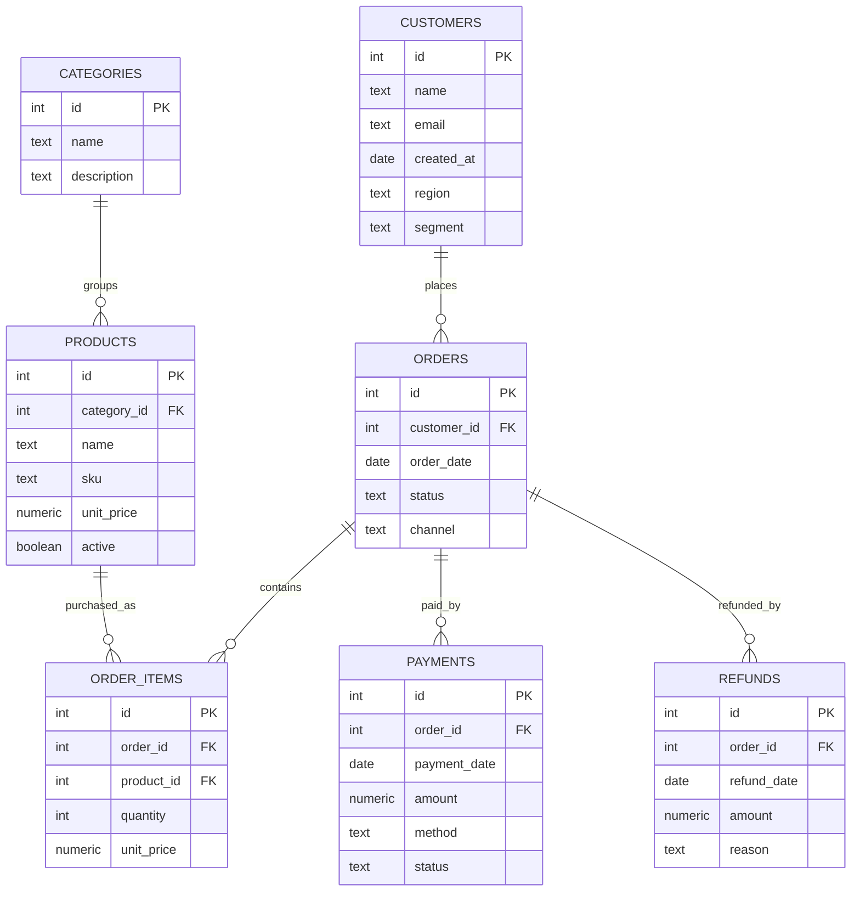
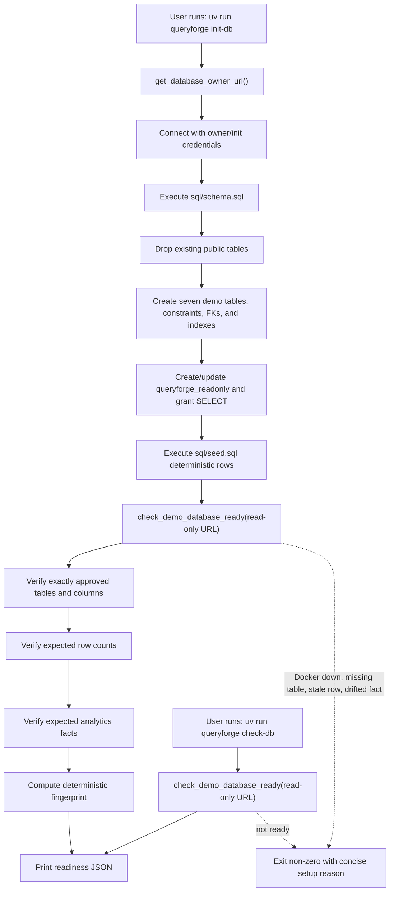
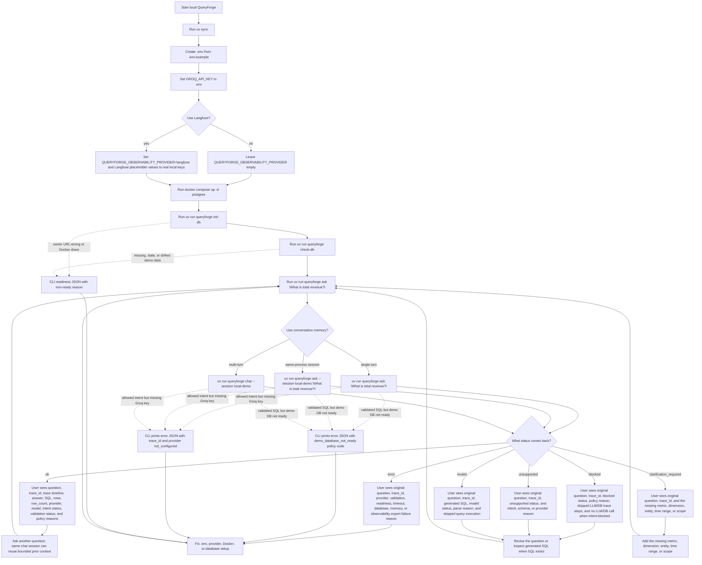
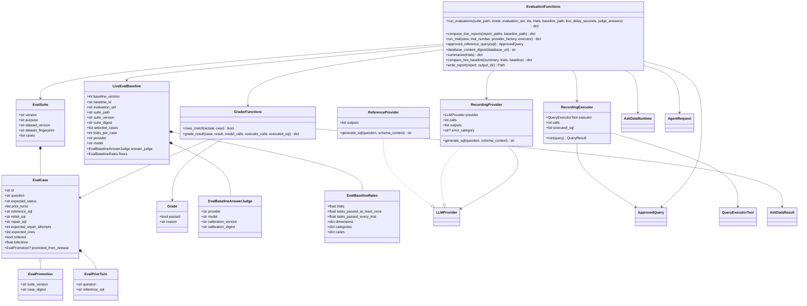
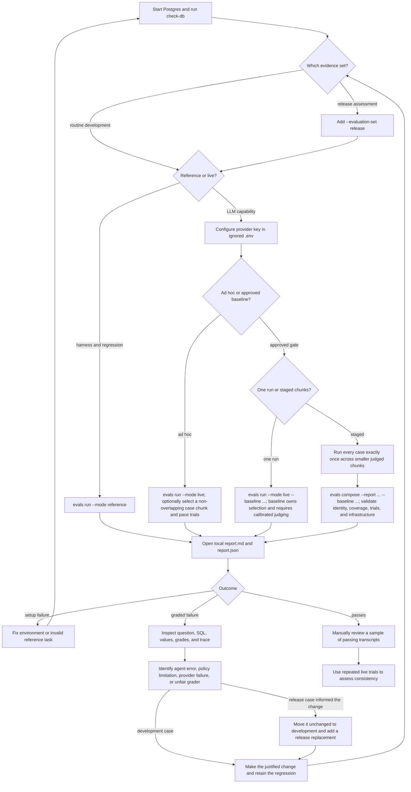

# QueryForge Architecture Diagrams

This is the living diagram page for QueryForge. Update it whenever an OpenSpec change alters the user flow, module boundaries, core classes, result models, statuses, setup steps, or execution path.

Current scope: local CLI and build-free browser Ask Data flows for a stabilized
seven-table Postgres demo database with required memory read/write workflow
boundaries, process-local CLI session memory, LangGraph orchestration, one
bounded SQL repair attempt, bounded local traces, structured provider failure
handling, optional Langfuse export, execution-time demo database readiness
checks, and reference/live evaluation commands.

## Demo Schema



## Database Setup Flow



## Code Flow

```mermaid
flowchart TD
    user["User runs: queryforge ask [--session id] <question> or queryforge chat --session id"] --> cli_main["cli.main()"]
    cli_main --> cli_ask["cli.ask(question, session_id) or cli.chat(session_id)"]

    cli_ask --> obs_config["load_observability_config()"]
    obs_config --> obs_exporter["create_trace_exporter(config)"]
    obs_exporter --> noop_exporter["NoOpTraceExporter when Langfuse is disabled"]
    obs_exporter --> langfuse_exporter["LangfuseTraceExporter when Langfuse is configured"]

    cli_ask --> query_tool["QueryExecutorTool()"]
    query_tool --> query_url["get_database_url() read-only execution URL"]
    cli_ask --> memory_store["CLI process InMemorySessionStore"]
    cli_ask --> runtime["AskDataRuntime(create_llm_provider, query_tool, memory_store, trace_exporter, trace_preview_rows)"]

    runtime --> request["AgentRequest(question, source=cli, session_id?)"]
    request --> ask_graph["AskDataGraph.run(request)"]
    ask_graph --> trace_id["generate_trace_id()"]
    ask_graph --> recorder["LocalTraceRecorder(question, trace_id)"]

    recorder --> memory_read["memory_read node"]
    memory_read --> memory_choice{"session_id present?"}
    memory_choice -- no --> memory_skip["Record no-session memory skip"]
    memory_choice -- yes --> load_memory["Load bounded same-session MemoryContext"]
    load_memory --> intent_node["intent_policy node"]
    memory_skip --> intent_node
    intent_node --> intent["evaluate_intent_policy(question)"]
    intent --> intent_decision{"IntentPolicyDecision.status"}

    intent_decision -- blocked --> skip_intent["Record skipped context, provider, semantic resolution, LLM SQL generation, validation, approval, query execution, and answer rendering"]
    intent_decision -- unsupported --> skip_intent
    intent_decision -- clarification_required --> skip_intent

    intent_decision -- provisionally allowed --> context_node["context_build node"]
    context_node --> context_builder["build_query_context(request, memory_context)"]
    context_builder --> query_context["QueryContext(schema_text plus bounded memory context, examples)"]

    query_context --> provider_node["provider_resolution node"]
    provider_node --> provider_factory["create_llm_provider()"]
    provider_factory --> dotenv["load_dotenv()"]
    dotenv --> provider_config["Read provider, model, and GROQ_API_KEY"]
    provider_config --> llm["LLMProvider implementation"]
    provider_factory -. missing provider config .-> skip_provider["Record provider error and skipped semantic resolution, SQL generation, validation, approval, and DB work"]

    llm --> semantic_node["semantic_metric_resolution node"]
    query_context --> semantic_node
    semantic_node --> resolver["resolve_metric_for_request(llm, request, context)"]
    resolver --> metric_call["llm.resolve_metric(question, schema context, governed catalog)"]
    metric_call --> metric_candidate["MetricResolutionCandidate from untrusted JSON"]
    metric_candidate --> metric_validator["parse_metric_resolution and validate catalog IDs plus status invariants"]
    metric_validator --> metric_decision{"MetricResolutionDecision.status"}
    metric_decision -- clarification_required --> skip_semantic["Return clarification_required; skip SQL generation, validation, approval, and DB work"]
    metric_validator -. malformed, unknown, or contradictory .-> skip_semantic_error["Return traceable error; skip SQL generation and DB work"]
    metric_call -. timeout, network, HTTP, or invalid transport response .-> skip_semantic_error

    metric_decision -- resolved or not_applicable --> generation_node["llm_sql_generation node"]
    generation_node --> generator["generate_sql_candidate(llm, request, context, validated resolution)"]
    generator --> llm_call["llm.generate_sql(question, context plus exact resolved definition when applicable)"]
    llm_call --> candidate["SQLCandidate(sql, provider, model, attempt)"]
    llm_call -. provider unsupported, timeout, network, invalid response, or unexpected provider error .-> skip_generation["Record generation failure and skipped validation, approval, and DB work"]

    candidate --> validation_node["sql_validation node"]
    validation_node --> approver["approve_sql_candidate(candidate)"]
    approver --> policy["evaluate_sql_policy(candidate.sql)"]
    policy --> cast_policy["AST safety: approved cast targets and bounded modifiers; nested operands still checked"]
    cast_policy --> sql_decision{"SQLPolicyDecision.status"}

    sql_decision -- blocked --> repair_check["Record sql_repair_eligibility"]
    sql_decision -- unsupported --> repair_check
    sql_decision -- invalid --> repair_check
    repair_check -- non-repairable or repair used --> skip_sql["Record SQL policy failure and skipped approval/query execution"]
    repair_check -- repairable and unused --> repair_generation["sql_repair_generation node"]
    repair_generation --> repair_generator["generate_repaired_sql_candidate(llm, request, context, validated resolution, failed SQL, failure source, failure reason)"]
    repair_generator --> repair_call["llm.generate_sql(repair prompt, context plus exact resolved definition when applicable)"]
    repair_call --> repair_candidate["SQLCandidate(sql, provider, model, attempt=2)"]
    repair_candidate --> validation_node
    repair_call -. provider unsupported, timeout, network, invalid response, or unexpected provider error .-> skip_sql
    sql_decision -- allowed --> approval_step["Record query_approval and create ApprovedQuery"]
    approval_step --> approved_query["ApprovedQuery(normalized_sql, policy decision)"]
    approved_query --> execution_node["query_execution node"]

    execution_node --> execute["query_tool.run(ApprovedQuery)"]
    execute --> revalidate["evaluate_sql_policy(approved_query.sql) again, including casts"]
    revalidate --> readiness_check["require_demo_database_ready(read-only URL)"]
    readiness_check --> readiness_payload["Verify version, table shape, row counts, facts, and fingerprint"]
    readiness_payload --> readonly_pg["Postgres read-only role via psycopg"]
    readonly_pg --> timeout["SET statement_timeout = '5s'"]
    timeout --> sql_execute["Execute normalized SELECT"]
    sql_execute --> rows["QueryResult rows + row_count"]

    revalidate -. policy mismatch .-> skip_execution["Record execution validation error and skipped answer rendering"]
    readiness_check -. missing, stale, drifted, or unreachable DB .-> skip_execution
    sql_execute -. non-repairable timeout, readiness, or database error .-> skip_execution
    sql_execute -. repairable SQL-shape database error and repair unused .-> repair_generation

    rows --> render_node["answer_rendering node"]
    render_node --> render["render_rows_as_answer(question, rows)"]
    render --> final_node["final_result node"]

    skip_intent --> final_node
    skip_provider --> final_node
    skip_semantic --> final_node
    skip_semantic_error --> final_node
    skip_generation --> final_node
    skip_sql --> final_node
    skip_execution --> final_node

    final_node --> memory_write["memory_write: save bounded turn summary or record skip/error"]
    memory_write --> finish_trace["recorder.finish(status)"]
    finish_trace --> export_trace{"Trace exporter"}
    export_trace -- local/no-op --> result["AskDataResult with request_id, trace_id, and bounded trace"]
    export_trace -- Langfuse configured --> langfuse["Export RunTrace events to Langfuse"]
    langfuse -. export failure .-> export_error["Record export error without changing query status"]
    langfuse --> result
    export_error --> result

    result --> json["Print AskDataResult-compatible JSON"]
```



## Local Browser Flow

The browser is a thin, stateless adapter over the same runtime. It cannot accept
SQL or call the query executor directly. The response model exposes only the
fields needed by the page and deliberately omits the full trace, prompts,
provider internals, raw exceptions, and credentials.

```mermaid
flowchart TD
    browser["Browser: one question form"] --> ask_api["POST /api/ask<br/>BrowserAskRequest"]
    ask_api --> ui_request["AgentRequest(question, source=ui, no session)"]
    ui_request --> runtime["Existing AskDataRuntime"]
    runtime --> graph["Existing AskDataGraph trust boundary"]
    graph --> intent["Intent policy + semantic metric resolution"]
    intent -- clarification required --> clarify_result["AskDataResult with validated question and candidates; no SQL/rows"]
    clarify_result --> safe_response["Allowlisted BrowserAskResponse"]
    safe_response --> clarify_ui["Suggestion buttons + free-text explanation"]
    clarify_ui --> explicit_question["Original question + explicit user clarification"]
    explicit_question --> ask_api
    intent -- allowed --> generation["LLM suggests candidate SQL"]
    generation --> validation["SQL validation + ApprovedQuery"]
    validation --> readonly["Read-only bounded Postgres execution"]
    readonly --> answer["Answer rendering + bounded rows + trace identity"]
    answer --> safe_response
    safe_response --> page["Separate answer and scrollable SQL-result panels"]

    schema_ui["Schema dropdown"] --> schema_api["GET /api/schema"]
    schema_api --> catalog["APPROVED_SCHEMA_CATALOG"]
    catalog --> schema_ui
    catalog --> prompt["render_schema_context()"]
    prompt --> graph
```

The approved schema catalog is the single structured source for browser table
metadata and LLM schema prose. It contains only the seven query-approved tables,
approved columns, descriptions, grains, and relationships; the endpoint does
not inspect Postgres catalogs. Browser input, clarification text, and LLM output
remain untrusted. Only QueryForge policy and `ApprovedQuery` can authorize the
read-only executor.

## Class Diagram

```mermaid
classDiagram
    class AskDataRuntime {
        +AskDataGraph _graph
        +run(request) AskDataResult
    }

    class AskDataGraph {
        +run(request) AskDataResult
        +load_memory(state) dict
        +evaluate_intent(state) dict
        +build_context(state) dict
        +resolve_provider(state) dict
        +resolve_metric(state) dict
        +generate_sql(state) dict
        +validate_sql(state) dict
        +repair_sql(state) dict
        +execute_query(state) dict
        +render_answer(state) dict
        +finalize_result(state) AskDataResult
    }

    class AskDataGraphState {
        <<TypedDict>>
        +AgentRequest request
        +str trace_id
        +TraceRecorder recorder
        +TraceExporter? trace_exporter
        +MemoryStore memory_store
        +MemoryContext? memory_context
        +ContextBuilder context_builder
        +QueryContext? context
        +LLMProvider? llm
        +MetricResolutionDecision? metric_resolution
        +SQLCandidate? candidate
        +list attempts
        +ApprovedQuery? approved_query
        +QueryResult? query_result
        +bool repair_used
        +str? repair_failure_source
        +str? repair_failure_reason
        +str? repair_failed_sql
        +IntentPolicyDecision? intent_decision
        +SQLPolicyDecision? sql_decision
        +AskDataResult? result
    }

    class AgentRequest {
        +str question
        +str request_id
        +RequestSource source
        +str? session_id
    }

    class QueryContext {
        +str schema_text
        +list examples
    }

    class ContextFunctions {
        +build_query_context(request, memory_context, schema_text) QueryContext
    }

    class MemoryStore {
        <<Protocol>>
        +str name
        +load(session_id) MemoryContext
        +append(session_id, turn) None
        +clear(session_id) None
    }

    class InMemorySessionStore {
        +str name
        +int max_turns
        +load(session_id) MemoryContext
        +append(session_id, turn) None
        +clear(session_id) None
    }

    class NoMemoryStore {
        +str name
        +load(session_id) MemoryContext
        +append(session_id, turn) None
        +clear(session_id) None
    }

    class MemoryContext {
        +str? session_id
        +list recent_turns
        +AnalysisReference? latest_analysis
        +int used_turn_count
    }

    class ConversationTurn {
        +str turn_id
        +str question
        +AgentStatus status
        +str? sql
        +list columns
        +int row_count
        +list preview_rows
        +str answer
        +str trace_id
        +str? policy_code
        +str? policy_reason
        +datetime created_at
    }

    class AnalysisReference {
        +str analysis_id
        +str question
        +str approved_sql
        +list columns
        +int row_count
        +list preview_rows
        +str answer
        +str trace_id
        +datetime created_at
    }

    class GenerationFunctions {
        +generate_sql_candidate(llm, request, context, metric_resolution) SQLCandidate
        +generate_repaired_sql_candidate(llm, request, context, metric_resolution, failed_sql, failure_source, failure_reason) SQLCandidate
    }

    class SemanticResolutionFunctions {
        +metric_catalog_context() str
        +resolve_metric_for_request(llm, request, context) MetricResolutionDecision
        +parse_metric_resolution(raw_candidate) MetricResolutionDecision
        +resolved_metric_definition(decision) MetricDefinition?
    }

    class MetricResolutionCandidate {
        +MetricResolutionStatus status
        +list candidate_metric_ids
        +str? resolved_metric_id
        +str reason
        +str? clarification_question
    }

    class MetricResolutionDecision {
        +MetricResolutionStatus status
        +list candidate_metric_ids
        +str? resolved_metric_id
        +str reason
        +str? clarification_question
    }

    class RepairFunctions {
        +validation_failure_is_repairable(decision) bool
        +execution_failure_is_repairable(error) bool
    }

    class SQLCandidate {
        +str sql
        +str provider
        +str model
        +int attempt
    }

    class PolicyDecision {
        +PolicyStatus status
        +str code
        +str reason
    }

    class ApprovedQuery {
        +str sql
        +PolicyDecision decision
    }

    class ApprovalFunctions {
        +approve_sql_candidate(candidate) tuple
    }

    class QueryResult {
        +str sql
        +list rows
        +int row_count
    }

    class LLMProvider {
        <<Protocol>>
        +str provider_name
        +str model_name
        +resolve_metric(question, schema_context, metric_catalog) str
        +generate_sql(question, schema_context) str
    }

    class OpenAICompatibleLLMProvider {
        +str provider_name
        +str model_name
        +str api_key
        +str base_url
        +float timeout_seconds
        +resolve_metric(question, schema_context, metric_catalog) str
        +generate_sql(question, schema_context) str
    }

    class GroqLLMProvider {
        +provider_name = "groq"
    }

    class QueryExecutorTool {
        +str database_url
        +bool check_readiness
        +run(query) QueryResult
    }

    class DemoDatabaseContract {
        +str DEMO_DATASET_VERSION
        +str DEMO_SCHEMA_NAME
        +tuple DEMO_TABLES
        +dict EXPECTED_ROW_COUNTS
        +dict EXPECTED_FACTS
        +str EXPECTED_DATASET_FINGERPRINT
    }

    class DemoDatabaseReadiness {
        +bool ready
        +str version
        +str? fingerprint
        +str expected_fingerprint
        +str reason
        +dict table_counts
        +dict facts
        +tuple missing_tables
        +tuple extra_tables
        +dict missing_columns
        +to_dict() dict
    }

    class DemoDatabaseNotReadyError {
        +DemoDatabaseReadiness readiness
    }

    class PostgresSupport {
        +get_database_owner_url() str
        +get_database_url() str
        +init_database() DemoDatabaseReadiness
        +check_demo_database_ready() DemoDatabaseReadiness
        +require_demo_database_ready() DemoDatabaseReadiness
    }

    class TraceRecorder {
        <<Protocol>>
        +record_step(name, status, metadata, error) TraceStep
        +record_skipped_step(name, reason, metadata) TraceStep
        +finish(status, metadata) RunTrace
        +record_export_error(provider, message) None
        +snapshot() RunTrace
    }

    class LocalTraceRecorder {
        +RunTrace trace
        +record_step(name, status, metadata, error) TraceStep
        +record_skipped_step(name, reason, metadata) TraceStep
        +finish(status, metadata) RunTrace
        +record_export_error(provider, message) None
        +snapshot() RunTrace
    }

    class TraceExporter {
        <<Protocol>>
        +str provider_name
        +export(trace) None
    }

    class NoOpTraceExporter {
        +provider_name = "local"
        +export(trace) None
    }

    class LangfuseTraceExporter {
        +provider_name = "langfuse"
        +from_config(config) LangfuseTraceExporter
        +export(trace) None
    }

    class ObservabilityConfig {
        +str provider
        +bool enabled
        +str? langfuse_public_key
        +str? langfuse_secret_key
        +str langfuse_base_url
        +int trace_preview_rows
        +list warnings
    }

    class AskDataResult {
        +str request_id
        +str question
        +AgentStatus status
        +str answer
        +str trace_id
        +RunTrace? trace
        +str? sql
        +list rows
        +int row_count
        +str provider
        +str model
        +IntentPolicyStatus? intent_status
        +SQLPolicyStatus? validation_status
        +str? policy_code
        +str? policy_reason
    }

    class RunTrace {
        +str trace_id
        +str question
        +AgentStatus? status
        +datetime started_at
        +datetime? finished_at
        +float? duration_ms
        +list TraceStep steps
        +list TraceExportError export_errors
    }

    class TraceStep {
        +str name
        +TraceStepStatus status
        +datetime started_at
        +datetime finished_at
        +float duration_ms
        +dict metadata
        +str? error
    }

    class IntentPolicy {
        +evaluate_intent_policy(question) IntentPolicyDecision
    }

    class SQLSafety {
        +evaluate_sql_policy(sql) SQLPolicyDecision
    }

    LLMProvider <|.. OpenAICompatibleLLMProvider
    OpenAICompatibleLLMProvider <|-- GroqLLMProvider
    AskDataRuntime --> AskDataGraph
    AskDataGraph --> AskDataGraphState
    AskDataGraph --> AgentRequest
    AskDataGraph --> MemoryStore
    AskDataGraph --> MemoryContext
    AskDataGraph --> ContextFunctions
    AskDataGraph --> SemanticResolutionFunctions
    AskDataGraph --> GenerationFunctions
    SemanticResolutionFunctions --> LLMProvider
    SemanticResolutionFunctions --> MetricResolutionCandidate
    SemanticResolutionFunctions --> MetricResolutionDecision
    MetricResolutionCandidate <|-- MetricResolutionDecision
    GenerationFunctions --> LLMProvider
    GenerationFunctions --> MetricResolutionDecision
    GenerationFunctions --> SQLCandidate
    AskDataGraph --> ApprovalFunctions
    AskDataGraph --> RepairFunctions
    ApprovalFunctions --> SQLCandidate
    ApprovalFunctions --> SQLPolicyDecision
    ApprovalFunctions --> ApprovedQuery
    ApprovedQuery --> PolicyDecision
    AskDataGraph --> LLMProvider
    AskDataGraph --> QueryExecutorTool
    AskDataGraph --> TraceRecorder
    AskDataGraph --> TraceExporter
    AskDataGraph --> IntentPolicy
    AskDataGraph --> AskDataResult
    AskDataGraph --> QueryResult
    QueryExecutorTool --> SQLSafety
    QueryExecutorTool --> ApprovedQuery
    QueryExecutorTool --> PostgresSupport
    QueryExecutorTool --> QueryResult
    InMemorySessionStore ..|> MemoryStore
    NoMemoryStore ..|> MemoryStore
    InMemorySessionStore --> ConversationTurn
    InMemorySessionStore --> AnalysisReference
    MemoryContext --> ConversationTurn
    MemoryContext --> AnalysisReference
    PostgresSupport --> DemoDatabaseContract
    PostgresSupport --> DemoDatabaseReadiness
    DemoDatabaseNotReadyError --> DemoDatabaseReadiness
    LocalTraceRecorder ..|> TraceRecorder
    NoOpTraceExporter ..|> TraceExporter
    LangfuseTraceExporter ..|> TraceExporter
    LocalTraceRecorder --> RunTrace
    RunTrace --> TraceStep
    AskDataResult --> RunTrace
```



## User Action Diagram



## Evaluation Code Flow

The eval runner is an external driver of `AskDataRuntime`; it does not create a
second SQL generation or execution path. Reference and live runs both use local
traces.

```mermaid
flowchart TD
    command["queryforge evals run"] --> baseline{"Approved live baseline?"}
    baseline -- yes --> baseline_load["Load strict v2 baseline; pin suite, cases, trials, agent, judge, calibration, and dataset"]
    baseline_load --> evidence_set{"Pinned evaluation set"}
    baseline -- no --> evidence_set{"Evaluation set"}
    evidence_set -- default development --> development["evals/ask-data/development.json"]
    evidence_set -- explicit release --> release["evals/ask-data/release.json"]
    development --> load["load_default_suites and select_cases"]
    release --> load
    load --> answer_contract["Validate human-reviewed answer expectations"]
    answer_contract --> judge_choice{"Baseline loaded or --judge-answers?"}
    judge_choice -- yes --> judge_calibration["Calibrate directness, completeness, and clarity judge"]
    judge_choice -- no --> contract["require_demo_database_ready and pinned contract check"]
    judge_calibration --> judge_compat{"Baseline judge and calibration identity match?"}
    judge_compat -- yes or no baseline --> contract
    judge_compat -. mismatch .-> invalid
    contract --> digest["database_content_digest of approved columns"]
    digest --> calibrate["Reference SQL approved by approve_sql_candidate"]
    calibrate --> reference_exec["Reference SQL through QueryExecutorTool as ApprovedQuery"]
    reference_exec --> reference_grade["rows_match against declared expected rows"]
    reference_grade --> fresh["Fresh agent, recording provider, recording executor per trial"]
    fresh --> memory_eval{"Case has prior_turns?"}
    memory_eval -- yes --> prior_session["Create fresh in-process memory session"]
    prior_session --> prior_runs["Run each prior turn through AskDataRuntime"]
    prior_runs --> request_final["Final AgentRequest(question, source=eval, same session_id)"]
    memory_eval -- no --> request_single["AgentRequest(question, source=eval)"]
    request_final --> runtime["AskDataRuntime.run using normal workflow"]
    request_single --> runtime
    runtime --> intent_check{"Normal intent policy"}
    intent_check -- allowed --> mode{"Provider mode"}
    mode -- reference --> scripted["ReferenceProvider returns reference SQL or scripted initial/repair SQL"]
    mode -- live --> configured["create_llm_provider uses local configuration"]
    scripted --> policy["Existing SQL approval and read-only execution policies"]
    configured --> policy
    intent_check -- local rejection --> result["AskDataResult and local trace"]
    policy --> repair_eval{"Repair needed?"}
    repair_eval -- yes --> repair_path["Normal workflow records repair eligibility and repair generation"]
    repair_path --> policy
    repair_eval -- no --> result
    result --> grades["grade_result: status, safety, results, diagnostics, answer grounding"]
    grades --> semantic_choice{"Judge requested and deterministic grades pass?"}
    semantic_choice -- yes --> semantic_grades["Judge directness, completeness, and clarity"]
    semantic_choice -- no --> semantic_skip["Record not requested or skipped prerequisites"]
    semantic_grades --> unchanged["Check content digest after trial"]
    semantic_skip --> unchanged
    unchanged --> repeat{"More cases or trials?"}
    repeat -- yes --> fresh
    repeat -- no --> aggregate["summarize trials and categories"]
    contract -. not ready .-> invalid["Invalid run, setup error, no aggregate score"]
    reference_grade -. wrong reference .-> invalid
    unchanged -. content changed .-> invalid
    aggregate --> compare{"Baseline loaded?"}
    compare -- yes --> baseline_gate["compare_live_baseline: hard safety, infrastructure, deterministic and subjective dimensions, category, and per-case floors"]
    compare -- no --> raw_gate["All selected trials must pass"]
    baseline_gate --> report["write_report: redact JSON and Markdown"]
    raw_gate --> report
    invalid --> report
    report --> exit_code["CLI exit 0 gate pass, 1 completed regression, 2 invalid or incompatible run"]
```



## Evaluation Class Relationships



## Evaluation User Actions



## Maintenance Checklist

- Update the code-flow diagram when the execution path changes.
- Update the class diagram when core classes, protocols, result models, or policy contracts change.
- Update the user action diagram when setup commands, CLI commands, or user-visible statuses change.
- Update `docs/demo-database.md` and its docs consistency test when seed facts or the dataset fingerprint change.
- Update evaluation diagrams when trial isolation, provider mode, grading, reports, or CLI selection changes; validate Mermaid syntax and check names against code.
- Keep module boundaries SOLID-aligned: providers generate candidates, policy validates, executors run approved work, observability records diagnostics, and agents/graphs orchestrate.
- Add abstractions only when they protect a real extension point or remove meaningful coupling.
- Keep future-stage features out of the current diagram until they exist in code.
