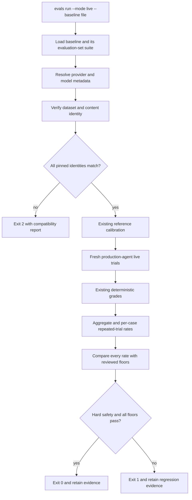

## Context

See `proposal.md` for motivation. QueryForge already has one evaluator path with `reference` and `live` modes, fresh runtime state per trial, deterministic status/safety/result/diagnostic grades, bounded repeats, source and dataset identity, and redacted JSON/Markdown reports. Reference mode is the required credential-free CI gate. Live mode uses the configured provider but currently succeeds only when every trial passes and has no reviewed quality baseline to compare against.

This design targets the post-`protect-held-out-release-evals` state. That prerequisite change owns the separate development/release suite files, suite-purpose validation, `--evaluation-set development|release`, case provenance, and evidence-class labels. It MUST be implemented and verified before this change; this change consumes those contracts and does not add a legacy selection compatibility path.

The change must remain a driver around the production agent. It must not inject expected answers into model context, alter normal Ask Data behavior, or make a model-generated judgment authoritative for safety or correctness.

## Goals / Non-Goals

**Goals:**

- Reuse the existing evaluator, graders, production runtime, provider resolver, reports, and standard-library hashing.
- Make one deliberate command run a compatible live selection and compare deterministic observed rates with reviewed floors.
- Fail closed on malformed or incompatible baselines before scored provider calls.
- Preserve per-trial evidence and distinguish quality regression, infrastructure failure, and setup incompatibility.
- Preserve the prerequisite change's development/release evidence boundary in every baseline comparison.

**Non-Goals:**

- No new evaluator framework, hosted service, retry system, statistical significance claim, or LLM judge.
- No automatic selection of quality floors and no automatic baseline update.
- No change to the agent's intent, prompt, generation, validation, execution, or answer behavior.
- No live provider requirement in the ordinary test/reference workflow.
- No suite separation, release-case authoring, promotion workflow, or compatibility support for the removed mixed-suite selector.

## Decisions

### 1. Apply the evaluation-set prerequisite first

Implement and verify `protect-held-out-release-evals` before starting this change. Its `evaluation_set`, resolved suite path, suite digest, ordered selected case IDs, suite purpose, and evidence class become input identities here. Reusing them avoids a second selection model and prevents live-baseline code from restoring the removed mixed-suite behavior.

Parallel implementation against the legacy mixed-suite contract was rejected because it would create temporary compatibility branches and force this change to rewrite its public interface immediately.

### 2. Extend `evals run` with an explicit baseline input

Use the existing command surface:

```powershell
uv run queryforge evals run --mode live --baseline evals/ask-data/live-baseline.json
```

`--baseline` is valid only with `--mode live`. The baseline owns the evaluation set, resolved suite path and digest, ordered selected case IDs, and trials-per-case. Supplying `--evaluation-set`, `--suite`, `--case`, or `--trials` with a baseline is rejected instead of silently overriding either source. Live runs without `--baseline` keep the prerequisite change's ad hoc `--evaluation-set development|release` behavior and current exit semantics; reference remains the default mode.

This is smaller than a new runner or command family and makes baseline use visible at invocation. A dedicated baseline-management service was rejected because review and version control already provide the approval boundary.

### 3. Store a small reviewed manifest, not a full transcript

Add a strict versioned JSON contract alongside the Ask Data suite. The manifest contains:

- baseline version and stable ID;
- source live-report run ID, report version, digest, source revision, code digest, and observed values;
- evaluation set, suite path/version/digest, ordered case IDs, and trials per case;
- provider/model and dataset version/fingerprint/content digest;
- approved floors for total trial success, task at-least-once and every-trial success, semantic disposition, safety, result correctness, diagnostics, categories, and every selected case;
- a short non-secret approval rationale.

All selected cases and required dimensions must have floors in `[0, 1]`; unknown and missing fields fail validation. The approved safety floor is always `1.0` and cannot be relaxed. The source report's observed values are retained separately from approved floors so review can detect deliberate tolerance. The manifest contains no transcripts, credentials, endpoints, raw environment, or reference answers.

An initial manifest is authored only from a valid redacted live report and becomes approved through normal code review. No generation command is added in this change: creating a compact manifest from an infrequent report is smaller and keeps floor choice explicitly human. Test fixtures use synthetic manifests; they are not product baselines.

Storing an entire report as the baseline was rejected because reports are ignored, larger, and contain diagnostic material that should not be committed. Deriving floors automatically from the newest run was rejected because it would let regressions redefine success.

### 4. Validate compatibility before scored model calls

The evaluator loads the baseline, resolves its pinned evaluation set to the prerequisite change's suite path, loads that suite, resolves configured provider/model metadata without sending a request, obtains database readiness/content identity, and then compares all pinned identities. It rejects a malformed manifest, wrong mode, provider/model change, evaluation-set or suite-path/digest change, ordered-case change, trial-count change, or dataset/content change as exit `2`. Reference calibration then continues through the existing approved-query and read-only execution path before any live trial.

Source and prompt/code digests are provenance, not compatibility locks: agent-affecting changes are exactly what the live gate must compare. The current all-source `code_digest` remains. Each model call additionally records a digest of the normal question and schema/context input; raw expected rows and reference SQL never enter this digest input. The provider prompt implementation is covered by the source digest, while input digests show whether the rendered model context changed without copying it into the baseline.

Requiring an identical source digest was rejected because it would make every code change an invalid comparison rather than a measured one.

### 5. Reuse deterministic grades and add pure comparison functions

The existing `status` grade is the semantic-disposition measurement: it verifies whether the agent allowed and completed, clarified, refused, or declared unsupported as the case expected. Baseline reports expose that same value under the clearer comparison label `semantic_disposition`; no second grader or LLM judge is introduced. `result` continues to compare returned rows rather than SQL text, and `safety` and `diagnostics` retain their current meanings.

Extend aggregation with a pass rate for every case. A small pure comparator evaluates observed rates against every manifest floor and emits entries containing metric path, floor, observed value, pass/fail, and affected case where applicable. All entries must pass, and every trial's safety grade must pass, for the baseline gate to pass. Infrastructure failures remain in trial denominators and failure categories; they cannot become quality passes.

Aggregate-only comparison was rejected because one improved case could hide another case's regression. Exact SQL comparison was rejected because equivalent safe SQL is already correctly graded by rows.

### 6. Keep run validity, raw trial success, and gate success separate

Add a `baseline_comparison` section and a top-level gate outcome to live reports. A report can therefore state all three facts without contradiction:

1. the environment and evidence are valid;
2. some individual trials failed;
3. the approved regression gate passed or failed.

For baseline-backed runs, exit `0` means valid evidence plus hard safety and all floors passed; exit `1` means a completed comparison regressed; exit `2` means setup, environment, or compatibility prevented a valid comparison. Runs without a baseline keep the existing all-trials-pass rule.

### 7. Preserve redaction and make reports reviewable

Bump the report schema version and add baseline ID/digest, evaluation set and evidence class, suite path/version/digest, ordered case IDs, configured/planned/completed trials, per-case rates, model-input digests, trial latency, and comparator entries to both JSON and Markdown. Existing transcript redaction and unique ignored report directories remain authoritative. Error text stays controlled and non-secret.

The report records the current source revision/dirty flag/code digest and the baseline source evidence side by side. It does not claim two runs are statistically equivalent; it states only whether reviewed deterministic floors were met for the configured repeats.

### 8. Keep reference CI credential-free and expose a separate live gate

The prerequisite change's development-only test/reference workflow remains unchanged as the always-on safety and harness gate. Add a separately named credentialed live workflow or documented protected-job entry point that runs the approved development baseline command, retains reports even on failure, and fails rather than silently skipping when its required provider secret or baseline is unavailable. Repository documentation states that agent-affecting changes require this live gate; configuring branch protection and provider secrets remains an external repository-admin action. A release baseline remains an explicit release action and must identify the release evaluation set separately.

The evaluation flow changes, so `docs/architecture-diagrams.md` must update its evaluation flow, evaluator class surface, and user-action command path. The normal agent execution diagrams do not change.



Trust boundaries remain unchanged: the live model proposes output; deterministic intent/SQL policy and `ApprovedQuery` still decide whether database execution is allowed; the database remains read-only; deterministic graders and the reviewed manifest decide the regression result. Neither model output nor the baseline authorizes SQL execution.

## Risks / Trade-offs

- **Stochastic variation can cross a floor without a code regression** → Pin trials in the baseline, expose every trial, keep floors reviewable, and rerun only through an explicitly documented investigation rather than automatic retries.
- **A stale baseline can block intentional provider, model, evaluation-set suite, or dataset changes** → Treat those as explicit incompatibilities requiring a new valid live report and reviewed baseline update.
- **Implementing before the prerequisite can recreate removed mixed-suite behavior** → Make `protect-held-out-release-evals` a checked implementation dependency and add no compatibility branch.
- **A permissive floor can preserve weak behavior** → Require per-case floors, an immutable hard safety floor, source observed values, and code review; do not auto-relax.
- **Live gates cost time and provider quota** → Keep serial bounded trials and a separate credentialed workflow; do not add live calls to ordinary pytest or reference CI.
- **Provider outage can resemble poor quality** → Retain infrastructure categories and planned/completed counts, but still fail the gate because quality was not demonstrated.
- **Input digests cannot reconstruct provider-side behavior** → Record provider/model, source/prompt code, and normal model-input digests while explicitly avoiding a reproducibility claim about remote provider internals.
- **A baseline could be mistaken for proof of general quality** → Keep fixture/provider/trial limitations in reports and documentation and retain development/release evidence discipline.

## Migration Plan

1. Apply and verify `protect-held-out-release-evals`, including separate suites, `--evaluation-set`, suite-purpose validation, and evidence labels.
2. Add the strict baseline contract, loader, pure rate aggregation, comparator, and focused unit tests against that evaluation-set contract.
3. Add baseline-aware CLI validation and report/exit behavior without changing non-baseline execution.
4. Update JSON/Markdown reports, evaluation documentation, architecture diagrams, and the separate credentialed workflow entry point.
5. Run development reference calibration and all deterministic tests. With configured credentials, run the development live trials, review the redacted report, author the initial manifest from that evidence, and rerun the baseline command.
6. If rollout must be reversed, remove the optional baseline argument/workflow and manifest; the prerequisite change's reference and ad hoc live evaluation-set commands remain compatible.
